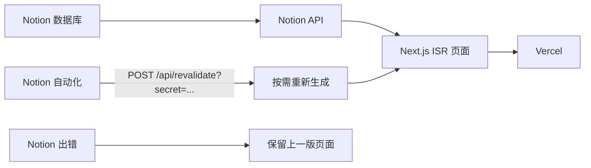

# Xuedi's Blog

用公开的 Notion 数据库做内容源，由 Next.js 在 Vercel 上以 ISR 渲染的个人博客。

线上站点：<https://blog-xuedixuedi.vercel.app>

[](https://github.com/Xuedixuedi/Xuedixuedi.github.io/actions/workflows/ci.yml)
[](https://blog-xuedixuedi.vercel.app)

这个项目最初用 Trae 和 Gemini-3-Pro 以 vibe coding 搭出来，界面参考了 [morethan-log](https://github.com/morethanmin/morethan-log)。现在由 AI coding agents 继续维护，改动经过 GitHub Actions CI 后才合并。

## 怎么工作

Notion 数据库经 Notion API 生成页面。文章更新靠 Notion 自动化调用重新生成接口。拉取失败时 `getStaticProps` 抛错，Next.js 继续提供上一版页面，空白结果不会写入缓存。



定时重新生成是兜底：`REVALIDATE_SECONDS` 默认 3600 秒。这次生成如果失败，同样抛错，已上线的页面保持不变。

## 快速开始

命令都在仓库根目录执行。克隆后的文件夹是 `Xuedixuedi.github.io`。`npm run dev` 之前，在该目录创建 `.env.local`，至少写入 `NOTION_PAGE_ID`（见下表）。

```bash
git clone https://github.com/Xuedixuedi/Xuedixuedi.github.io.git
cd Xuedixuedi.github.io
npm install
npm run dev
```

开发服务器在 <http://localhost:3000>。数据库需要在 Notion 里开启 Share to web：`notion-client` 不带集成 token，只读公开页面。

## 环境变量

| 变量 | 作用 | 必填 | 在哪设置 |
| --- | --- | --- | --- |
| `NOTION_PAGE_ID` | Notion 数据库页面 ID，赋给 `site.config.js` 的 `notionConfig.pageId`。为空时构建直接抛错 | 本地和 Vercel 必填。CI 未设置时使用公开库 `f93701d92ba04185952511e3d047bb4d` | `.env.local`；Vercel Environment Variables。CI 读 Actions variable 或 secret |
| `REVALIDATE_SECRET` | 校验 `POST /api/revalidate`。可放在 `?secret=`、请求头 `x-revalidate-secret`，或 `Authorization: Bearer`。未设置时接口返回 401 | 使用 Notion webhook 时必填 | 只放在 Vercel。不要写入仓库 |
| `REVALIDATE_SECONDS` | ISR 间隔（秒），默认 `3600`，必须是正整数。sitemap 的 `s-maxage` 使用同一个值 | 否 | `.env.local` 或 Vercel |
| `NEXT_PUBLIC_SITE_URL` | 规范站点地址，写入 canonical、Open Graph、Twitter 和 sitemap。未设置时看 `SITE_URL`，再没有则是 `https://blog-xuedixuedi.vercel.app` | 否 | `.env.local` 或 Vercel |
| `SITE_URL` | 服务端别名，仅在 `NEXT_PUBLIC_SITE_URL` 未设置时生效。构建会把它折进 `NEXT_PUBLIC_SITE_URL`，避免浏览器和服务器各用一个地址 | 否 | `.env.local` 或 Vercel |
| `NEXT_PUBLIC_GOOGLE_MEASUREMENT_ID` | `site.config.js` 里的 Analytics ID。`googleAnalytics.enable` 现为 `false`，页面未读取 | 否 | `.env.local` 或 Vercel |
| `NEXT_PUBLIC_GOOGLE_SITE_VERIFICATION` | Search Console 验证码。`googleSearchConsole.enable` 现为 `false`，页面未读取 | 否 | `.env.local` 或 Vercel |
| `VERCEL_ENV` | 等于 `production` 时 `CONFIG.isProd` 为 true。当前没有页面读取该字段 | 否，Vercel 自动注入 | Vercel |

`.env*.local` 已在 `.gitignore` 中。

Page ID 是公开链接末尾的 32 位 ID，例如 `https://www.notion.so/Page-Title-1234567890abcdef1234567890abcdef` 中的 `1234567890abcdef1234567890abcdef`。

## Notion 数据库属性

属性名按大小写匹配。一行要同时满足 `Type` 为 `Post`、`Status` 为 `Published` 才会出现在站点上。

| 属性 | 类型 | 说明 |
| --- | --- | --- |
| `Title` | Title | 标题。没有 `Title` 时依次尝试 `Name` 和 Notion 的 `title` |
| `Slug` | Text | URL 路径，例如 `my-first-post`。留空时用页面 block id |
| `Date` | Date | 发布日期。留空时用创建时间 |
| `Tags` | Multi-select | 标签，可空 |
| `Summary` | Text | 列表摘要，可空 |
| `Thumbnail` | Files | 封面，可空。S3 链接会改写成 Notion 图片代理 |
| `Type` | Select | 必须为 `Post`。留空或没有该属性时按 `Post` 处理 |
| `Status` | Select | 必须为 `Published`。留空或没有该属性时按 `Published` 处理 |

## 部署

**Vercel 是博客的唯一运行环境。** 把 GitHub 仓库导入 Vercel，设置 `NOTION_PAGE_ID` 和 `REVALIDATE_SECRET` 后部署。页面使用 ISR，`fallback` 为 `blocking`，`/api/revalidate` 可用。规范域名是 <https://blog-xuedixuedi.vercel.app>。`site.config.js` 的 `link` 读 `NEXT_PUBLIC_SITE_URL` 或 `SITE_URL`，默认就是这个地址。

**GitHub Pages 只做跳转。** 仓库名仍是 `Xuedixuedi.github.io`，所以 <https://xuedixuedi.github.io> 还会打开。[`.github/workflows/deploy.yml`](.github/workflows/deploy.yml) 不再构建博客，也没有每日定时任务。它只在推送到 `main` 且 `gh-pages-redirect/` 或该工作流有改动时，以及手动触发时，把 `gh-pages-redirect/index.html` 和 `404.html` 发布上去。浏览器用 `location.replace` 跳到 Vercel 上的同一路径（保留 pathname、search、hash）。不执行脚本时，meta refresh 和 canonical 回到站点根。

同一账号下的项目站点（例如 `/WishKit-LoveAndDeepspace/`）由各自仓库发布。GitHub 会先把这些路径交给对应仓库，本仓库的跳转页碰不到它们。

## 用 Notion 自动更新

1. 在 Vercel 设置 `REVALIDATE_SECRET`。
2. 在 Notion 数据库上建 Automation：文章新增或属性变更时发送 Webhook。
3. 请求方法用 **POST**，地址：

   `https://blog-xuedixuedi.vercel.app/api/revalidate?secret=<REVALIDATE_SECRET>`

   GET 会得到 405，缓存不动。密钥也可以放在 `x-revalidate-secret` 或 `Authorization: Bearer <REVALIDATE_SECRET>`。
4. Notion 自动化的 body 形状不固定。body 里没有可用的 `slug` 或 `slugs` 时，重新生成首页和每一篇已发布文章。body 里带了 `slug`（字符串）或 `slugs`（字符串数组）时，只重新生成首页和这些路径。这些路径先等文章列表返回，再以最多 4 路并发执行（`Promise.allSettled`）。路由配置了 `maxDuration: 60`，避免在 Vercel 默认 10 秒限制下整站重新生成超时。
5. 列出文章失败或没有已发布文章时，接口返回 500，不会调用重新生成。某一条路径生成失败时，整体也返回 500，响应里的 `results` 逐条标出成功或失败，`paths` 只包含成功的路径。失败的那一页不会覆盖已缓存的内容；同一请求里成功的路径会更新。

## 配置

站点文案和账号在 [`site.config.js`](site.config.js)：`profile`（名字、头像、简介、社交链接）、`blog`（标题、描述、主题）、`since`、`lang`、`link`（规范站点地址）、`notionConfig.pageId`，以及 Utterances 评论仓库。`notionConfig.pageId` 读取环境变量 `NOTION_PAGE_ID`。`link` 读取 `NEXT_PUBLIC_SITE_URL` 或 `SITE_URL`。

## CI 与 Dependabot

[`.github/workflows/ci.yml`](.github/workflows/ci.yml) 在 push、pull request、每天 UTC 02:00 和手动触发时运行，Node.js 22。常规检查是 `npm ci`、`npm run typecheck`、`npm test`、`npm run smoke:notion`，以及一次 `npm run build`（与 Vercel 相同的 ISR）。定时任务只跑 Notion smoke，用来发现 Notion API 变化。合并前 CI 需要通过。

Dependabot（[`.github/dependabot.yml`](.github/dependabot.yml)）每周一 09:00（Asia/Singapore）检查 npm 和 GitHub Actions。`open-pull-requests-limit: 0` 关掉常规版本更新 PR，安全更新仍会打开。`next`、`react`、`react-dom`、`@types/node` 的 major 版本更新被忽略。

## 致谢

视觉和功能参考 [morethan-log](https://github.com/morethanmin/morethan-log)。

## 许可证

[MIT](LICENSE)。Copyright (c) 2026 Xuedi Liu。
