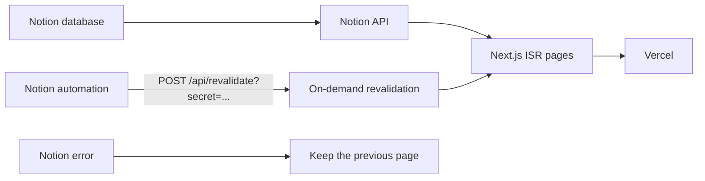

English | [简体中文](./README.zh-CN.md)

# Xuedi's Blog

A personal blog that uses a public Notion database as its content source and is rendered with Next.js ISR on Vercel.

Live site: <https://blog-xuedixuedi.vercel.app>

[](https://github.com/Xuedixuedi/Xuedixuedi.github.io/actions/workflows/ci.yml)
[](https://blog-xuedixuedi.vercel.app)

The project was first put together with Trae and Gemini-3-Pro through vibe coding. The interface follows [morethan-log](https://github.com/morethanmin/morethan-log). AI coding agents maintain it now, and changes are merged only after GitHub Actions CI passes.

## How it works

The Notion database is turned into pages through the Notion API. Post updates depend on a Notion automation that calls the revalidation endpoint. When a fetch fails, `getStaticProps` throws, Next.js keeps serving the previous page, and an empty result is never written into the cache.



Scheduled revalidation is the fallback: `REVALIDATE_SECONDS` defaults to 3600 seconds. If that generation fails, it throws the same way, and the page already live stays unchanged.

## Quick start

Run every command from the repository root. The folder after cloning is `Xuedixuedi.github.io`. Before `npm run dev`, create `.env.local` in that directory and set at least `NOTION_PAGE_ID` (see the table below).

```bash
git clone https://github.com/Xuedixuedi/Xuedixuedi.github.io.git
cd Xuedixuedi.github.io
npm install
npm run dev
```

The dev server is at <http://localhost:3000>. The database must have Share to web turned on in Notion: `notion-client` carries no integration token and only reads public pages.

## Environment variables

| Variable | Purpose | Required | Where to set it |
| --- | --- | --- | --- |
| `NOTION_PAGE_ID` | Notion database page ID, assigned to `notionConfig.pageId` in `site.config.js`. The build throws immediately when it is empty | Required locally and on Vercel. When CI leaves it unset, the public database `f93701d92ba04185952511e3d047bb4d` is used | `.env.local`; Vercel Environment Variables. CI reads an Actions variable or secret |
| `REVALIDATE_SECRET` | Authenticates `POST /api/revalidate`. It may be sent as `?secret=`, the `x-revalidate-secret` header, or `Authorization: Bearer`. The endpoint returns 401 when it is unset | Required when using the Notion webhook | Vercel only. Do not commit it to the repository |
| `REVALIDATE_SECONDS` | ISR interval in seconds. Defaults to `3600` and must be a positive integer. The sitemap `s-maxage` uses the same value | No | `.env.local` or Vercel |
| `NEXT_PUBLIC_SITE_URL` | Canonical site URL, written into canonical, Open Graph, Twitter, and the sitemap. When unset, `SITE_URL` is used, then `https://blog-xuedixuedi.vercel.app` | No | `.env.local` or Vercel |
| `SITE_URL` | Server-side alias, used only when `NEXT_PUBLIC_SITE_URL` is unset. The build folds it into `NEXT_PUBLIC_SITE_URL` so the browser and the server do not each use a different address | No | `.env.local` or Vercel |
| `NEXT_PUBLIC_GOOGLE_MEASUREMENT_ID` | Analytics ID in `site.config.js`. `googleAnalytics.enable` is currently `false`, and pages do not read it | No | `.env.local` or Vercel |
| `NEXT_PUBLIC_GOOGLE_SITE_VERIFICATION` | Search Console verification code. `googleSearchConsole.enable` is currently `false`, and pages do not read it | No | `.env.local` or Vercel |
| `VERCEL_ENV` | `CONFIG.isProd` is true when this equals `production`. No page reads that field today | No; Vercel injects it automatically | Vercel |

`.env*.local` is listed in `.gitignore`.

The page ID is the 32-character ID at the end of a public link. In `https://www.notion.so/Page-Title-1234567890abcdef1234567890abcdef`, that ID is `1234567890abcdef1234567890abcdef`.

## Notion database properties

Property names are matched case-sensitively. A row appears on the site only when `Type` is `Post` and `Status` is `Published`.

| Property | Type | Notes |
| --- | --- | --- |
| `Title` | Title | Title. When `Title` is missing, `Name` is tried next, then Notion's `title` |
| `Slug` | Text | URL path, for example `my-first-post`. When empty, the page block id is used |
| `Date` | Date | Publish date. When empty, the created time is used |
| `Tags` | Multi-select | Tags. May be empty |
| `Summary` | Text | Excerpt shown in lists. May be empty |
| `Thumbnail` | Files | Cover image. May be empty. S3 links are rewritten through the Notion image proxy |
| `Type` | Select | Must be `Post`. An empty value, or a missing property, is treated as `Post` |
| `Status` | Select | Must be `Published`. An empty value, or a missing property, is treated as `Published` |

## Deployment

**Vercel is the only runtime for the blog.** Import the GitHub repository into Vercel, set `NOTION_PAGE_ID` and `REVALIDATE_SECRET`, then deploy. Pages use ISR, `fallback` is `blocking`, and `/api/revalidate` is available. The canonical domain is <https://blog-xuedixuedi.vercel.app>. `link` in `site.config.js` reads `NEXT_PUBLIC_SITE_URL` or `SITE_URL`, and that address is the default.

**GitHub Pages only redirects.** The repository name is still `Xuedixuedi.github.io`, so <https://xuedixuedi.github.io> still opens. [`.github/workflows/deploy.yml`](.github/workflows/deploy.yml) no longer builds the blog, and it has no daily scheduled job. It publishes `gh-pages-redirect/index.html` and `404.html` only on a push to `main` that changes `gh-pages-redirect/` or that workflow, and when triggered manually. The browser uses `location.replace` to jump to the same path on Vercel (pathname, search, and hash are kept). When scripts do not run, meta refresh and the canonical link fall back to the site root.

Project sites under the same account (for example `/WishKit-LoveAndDeepspace/`) are published from their own repositories. GitHub hands those paths to the matching repository first, so this repository's redirect page never sees them.

## Automatic updates from Notion

1. Set `REVALIDATE_SECRET` on Vercel.
2. Create an Automation on the Notion database: send a webhook when a post is added or its properties change.
3. Use **POST**. The URL is:

   `https://blog-xuedixuedi.vercel.app/api/revalidate?secret=<REVALIDATE_SECRET>`

   GET returns 405 and leaves the cache untouched. The secret may also be sent in `x-revalidate-secret` or `Authorization: Bearer <REVALIDATE_SECRET>`.
4. A Notion automation body does not have a fixed shape. When the body has no usable `slug` or `slugs`, the home page and every published post are regenerated. When the body includes `slug` (a string) or `slugs` (an array of strings), only the home page and those paths are regenerated. Those paths wait until the post list returns, then run with at most 4 in flight (`Promise.allSettled`). The route sets `maxDuration: 60` so a full-site regeneration does not time out under Vercel's default 10-second limit.
5. If listing posts fails, or there are no published posts, the endpoint returns 500 and does not call revalidation. If any single path fails to generate, the response is also 500. `results` marks each path as success or failure, and `paths` contains only the successful ones. A failed page does not overwrite content already in the cache; paths that succeed in the same request are updated.

## Configuration

Site copy and accounts live in [`site.config.js`](site.config.js): `profile` (name, avatar, bio, social links), `blog` (title, description, theme), `since`, `lang`, `link` (canonical site URL), `notionConfig.pageId`, and the Utterances comment repository. `notionConfig.pageId` reads the `NOTION_PAGE_ID` environment variable. `link` reads `NEXT_PUBLIC_SITE_URL` or `SITE_URL`.

## CI and Dependabot

[`.github/workflows/ci.yml`](.github/workflows/ci.yml) runs on push, pull request, every day at 02:00 UTC, and manual dispatch, on Node.js 22. The regular checks are `npm ci`, `npm run typecheck`, `npm test`, `npm run smoke:notion`, and one `npm run build` (the same ISR build as Vercel). The scheduled job runs only the Notion smoke check, to catch changes in the Notion API. CI must pass before merge.

Dependabot ([`.github/dependabot.yml`](.github/dependabot.yml)) checks npm and GitHub Actions every Monday at 09:00 (Asia/Singapore). `open-pull-requests-limit: 0` turns off routine version-update pull requests; security updates still open. Major updates of `next`, `react`, `react-dom`, and `@types/node` are ignored.

## Acknowledgements

Visual design and features follow [morethan-log](https://github.com/morethanmin/morethan-log).

## License

[MIT](LICENSE). Copyright (c) 2026 Xuedi Liu.
